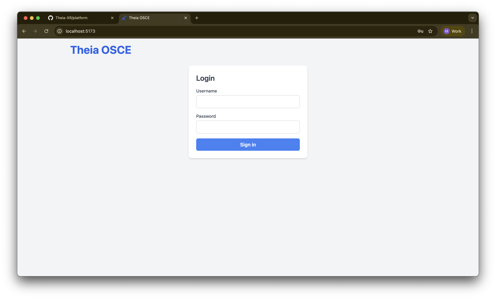
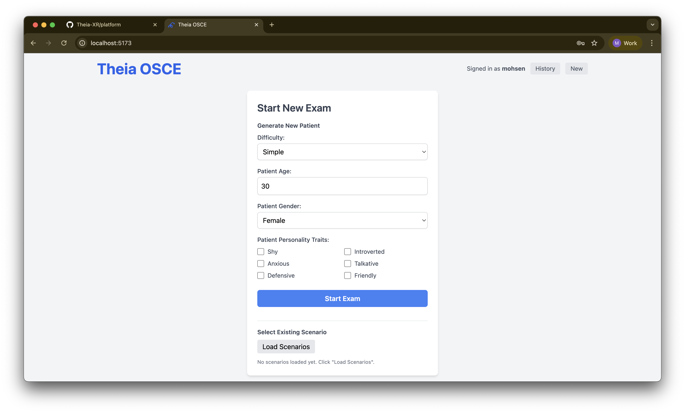
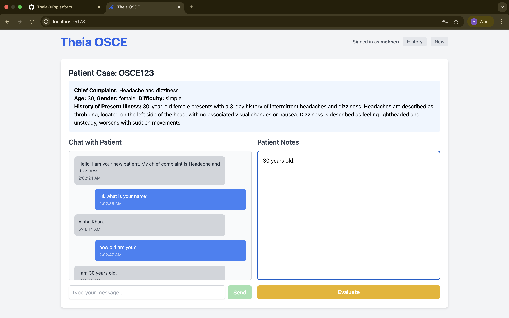
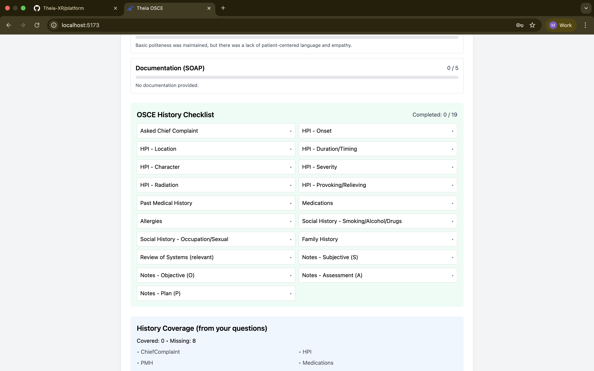

# Theia OSCE Simulator

A modern web application for simulating Objective Structured Clinical Examinations (OSCEs) using AI-powered patient interactions.

## Overview

Theia OSCE Simulator helps medical students and healthcare professionals practice clinical examinations with AI-generated virtual patients. The application leverages LangChain and OpenAI's GPT models to create realistic patient cases with persistent memory and configurable parameters such as:

- Difficulty level (simple, medium, hard)
- Patient demographics (age, gender, realistic names)
- Personality traits (shy, anxious, talkative, etc.)
- Behavioral characteristics
- Persistent conversation memory

## Features

- **Dynamic Patient Generation**: Create unique patient cases with realistic names based on configurable parameters
- **Interactive Chat Interface**: Conduct realistic conversations with AI patients using LangChain
- **Persistent Memory**: Patients remember everything discussed throughout the conversation
- **Customizable Patient Traits**: Configure personality traits to simulate diverse patient interactions
- **Comprehensive Case Details**: Access detailed patient history, symptoms, and medical information
- **Memory Management**: View conversation history and clear patient memory when needed
- **Structured Output**: Enhanced AI responses with better parsing and validation
- **Responsive Design**: Works on desktop and mobile devices

## Screenshots

Below are example screens from the app. Images are stored under `osce-simulator/docs/screenshots/`.

### Login


### Start New Exam


### Chat with Patient and Notes


### Evaluation and OSCE Checklist


## Tech Stack

### Backend
- FastAPI (Python)
- LangChain framework
- OpenAI API integration
- Persistent conversation memory
- Structured output parsing with Pydantic
- Uvicorn ASGI server

### Frontend
- React.js
- TypeScript
- Tailwind CSS
- Axios for API communication

### Deployment
- Docker
- Docker Compose
- Nginx (for frontend serving)

## Project Structure

```
theia/
├── README.md                       # Project README with Docker instructions
└── osce-simulator/                 # Main project directory
    ├── README.md                   # OSCE Simulator README
    ├── DOCKER_README.md            # Docker-specific documentation
    ├── docker-compose.yml          # Docker Compose configuration
    ├── docker-run.sh               # Script to run dockerized application
    ├── run.py                      # Python script for running the application
    ├── run.sh                      # Shell script for running the application
    ├── backend/                    # Backend application (FastAPI)
    │   ├── Dockerfile              # Docker configuration for backend
    │   ├── requirements.txt        # Python dependencies
    │   ├── pyproject.toml          # Python project configuration
    │   ├── run_with_uv.sh          # Script for running with uv
    │   ├── run_api_test.py         # API testing script
    │   ├── test_key.py             # OpenAI key testing script
    │   ├── test_openai.py          # OpenAI integration test
    │   └── app/                    # Main application code
    │       ├── main.py             # FastAPI application entry point
    │       ├── api/                # API endpoints
    │       ├── core/               # Core functionality
    │       │   └── config.py       # Application configuration
    │       ├── models/             # Database models
    │       ├── schemas/            # Pydantic schemas
    │       │   ├── chat.py         # Chat message schemas
    │       │   └── patient.py      # Patient data schemas
    │       ├── services/           # Business logic services
    │       │   └── langchain_service.py # LangChain integration with memory
    │       └── utils/              # Utility functions
    └── frontend/                   # Frontend application (React)
        ├── Dockerfile              # Docker configuration for frontend
        ├── nginx.conf              # Nginx configuration for serving frontend
        ├── package.json            # NPM package configuration
        ├── index.html              # HTML entry point
        ├── vite.config.ts          # Vite configuration
        ├── tsconfig.json           # TypeScript configuration
        ├── tailwind.config.cjs     # Tailwind CSS configuration
        ├── postcss.config.cjs      # PostCSS configuration
        └── src/                    # Source code
            ├── App.tsx             # Main React component
            ├── main.tsx            # Application entry point
            ├── components/         # React components
            │   ├── EvaluationPage.tsx # Evaluation page component
            │   ├── ExamPage.tsx    # Exam page component
            │   └── PatientSetup.tsx # Patient setup component
            ├── services/           # API services
            │   └── api.ts          # API client
            └── types/              # TypeScript type definitions
                └── index.ts        # Type exports
```

## Getting Started

### Prerequisites

- Node.js (v14 or later)
- Python (v3.8 or later)
- OpenAI API key
- Docker and Docker Compose (for containerized deployment)

### Installation

#### Option 1: Standard Setup

1. Clone the repository:
   ```
   git clone https://github.com/mohsenism/theia.git
   cd theia
   ```

2. Set up the backend:
   ```
   cd osce-simulator/backend
   python -m venv venv
   source venv/bin/activate  # On Windows: venv\Scripts\activate
   pip install -r requirements.txt
   ```

3. Configure your OpenAI API key:
   - Create a `.env` file in the `osce-simulator/backend` directory
   - Add your OpenAI API key: `OPENAI_API_KEY=your_openai_api_here`

4. Set up the frontend:
   ```
   cd ../frontend
   npm install
   ```

#### Option 2: Docker Setup

1. Clone the repository:
   ```
   git clone https://github.com/mohsenism/theia.git
   cd theia/osce-simulator
   ```

2. Create a `.env` file in the `osce-simulator` directory:
   ```
   # OpenAI API key (required)
   OPENAI_API_KEY=your_openai_api_key_here
   ```

3. Build and start the Docker containers:
   ```
   ./docker-run.sh
   ```
   
   Or manually with Docker Compose:
   ```
   docker-compose up -d --build
   ```

4. Access the application:
   - Frontend: http://localhost:5173
   - Backend API: http://localhost:8000
   - API Documentation: http://localhost:8000/docs

### Running the Application

#### Standard Method

The application can be started using the provided script:

```
cd osce-simulator
./run.sh
```

This script starts both the backend API server and the frontend development server:
- Backend: http://localhost:8000
- Frontend: http://localhost:5173

#### Docker Method

To start the application using Docker:

```
cd osce-simulator
./docker-run.sh
```

To stop the Docker containers:

```
docker-compose down
```

## Usage

1. **Start a New Exam**: Configure the patient parameters (difficulty, age, gender, personality traits)
2. **Review Patient Case**: Once generated, review the patient's chief complaint and medical history
3. **Conduct the Interview**: Use the chat interface to ask questions and gather information
4. **Practice Clinical Skills**: Work through the case as you would in a real OSCE examination

## API Endpoints

### Core Functionality
- `GET /api/settings` - Get available settings for patient case generation
- `POST /api/patient` - Generate a new patient case with realistic name
- `GET /api/patient/{case_id}` - Get a specific patient case
- `POST /api/chat` - Chat with a patient (with persistent memory)
- `POST /api/evaluate` - Evaluate a student's response

### Memory Management
- `GET /api/conversation/{case_id}/history` - Get conversation history for a case
- `DELETE /api/conversation/{case_id}/memory` - Clear conversation memory for a case

### Health Check
- `GET /api/health` - Check API health status

## Docker Deployment

The application is containerized using Docker with separate containers for the frontend and backend:

- **Backend Container**: Python FastAPI application running on Uvicorn
- **Frontend Container**: React application served via Nginx

The containers communicate through a Docker network and can be easily deployed to any environment supporting Docker.

For detailed Docker configuration information, see [DOCKER_README.md](osce-simulator/DOCKER_README.md).

## Contributing

1. Fork the repository
2. Create your feature branch (`git checkout -b feature/amazing-feature`)
3. Commit your changes (`git commit -m 'Add some amazing feature'`)
4. Push to the branch (`git push origin feature/amazing-feature`)
5. Open a Pull Request

## License

This project is licensed under the MIT License - see the LICENSE file for details.

## Acknowledgments

- [OpenAI](https://openai.com/) for providing the AI models
- All contributors to the project

