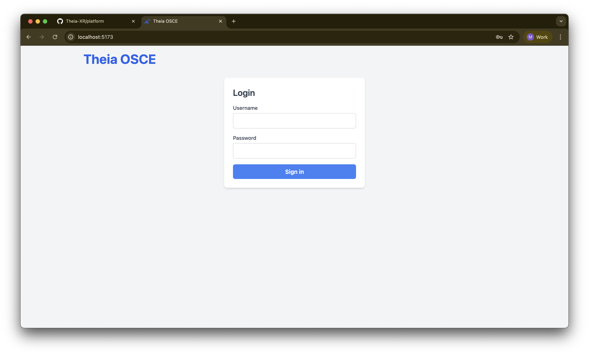
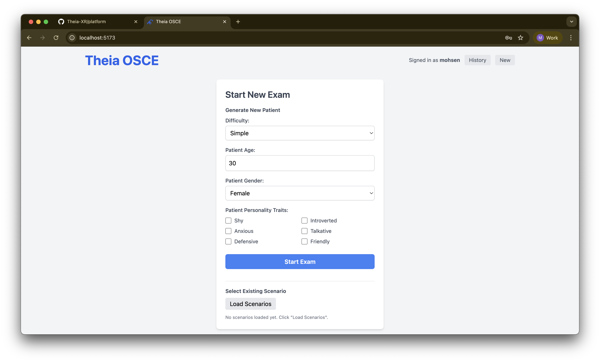
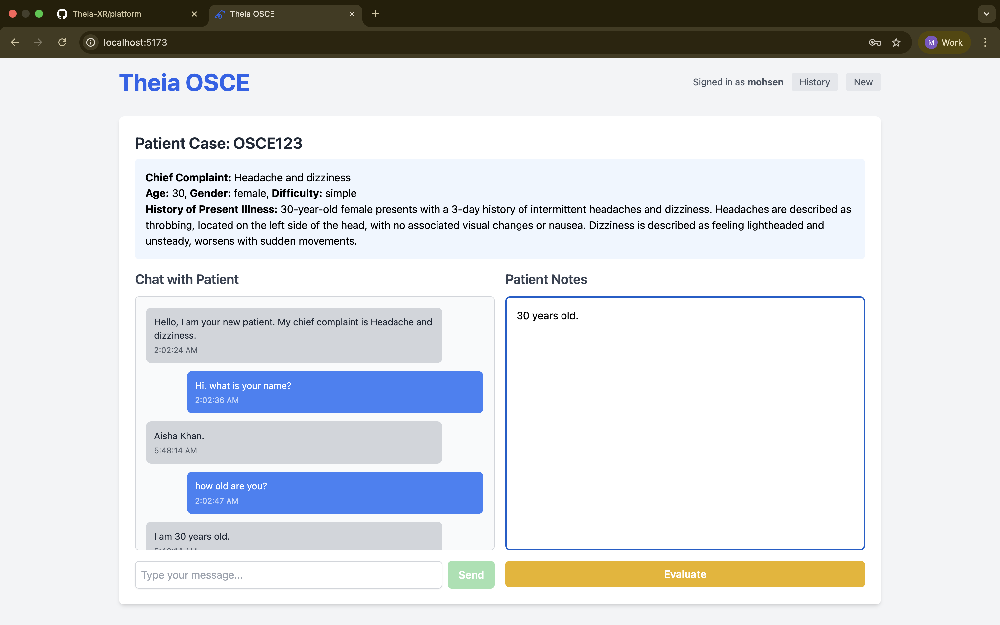
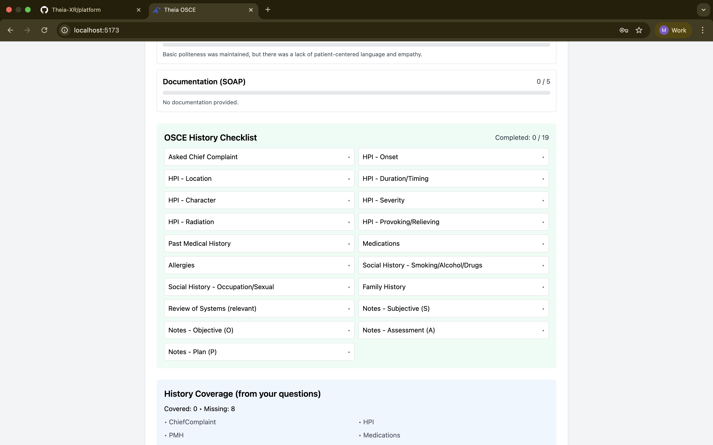

# OSCE Simulation Web App

A web-based OSCE (Objective Structured Clinical Examination) simulation app that uses LangChain and OpenAI's GPT-3.5 to generate realistic patient interactions with persistent memory and evaluate student responses.

## Features

- **Advanced Patient Generation** with LangChain:
  - Realistic patient names based on demographics
  - Difficulty levels (simple, medium, hard)
  - Patient demographics (age, gender)
  - Personality traits and behavioral settings
  - Structured output with enhanced validation
- **Persistent Memory Management**:
  - Patients remember entire conversation history
  - Memory management APIs for viewing and clearing history
  - Consistent patient identity throughout sessions
- **Enhanced AI Interactions**:
  - LangChain-powered conversation chains
  - Better prompt management and response parsing
  - Improved error handling and response validation
- **Comprehensive Evaluation System**:
  - Evaluate student responses based on OSCE rubrics
  - Detailed feedback and scoring
- **Developer Experience**:
  - Interactive API documentation with Swagger UI
  - Rate limiting and CORS support
  - Docker containerization
- **Future Ready**:
  - Ready for Unity VR integration
  - Extensible architecture with LangChain

## Screenshots

Below are example screens from the app. If viewing on GitHub, images will render when the `docs/screenshots` assets are present in the repository.

### Login


### Start New Exam


### Chat with Patient and Notes


### Evaluation and OSCE Checklist


## Backend Setup

### Using pip (traditional method)

1. Create a virtual environment:
```bash
python -m venv venv
source venv/bin/activate  # On Windows: venv\Scripts\activate
```

2. Install dependencies:
```bash
cd backend
pip install -r requirements.txt
```

### Using uv (faster alternative)

1. Install uv if you don't have it already:
```bash
# With pip
pip install uv

# With Homebrew on macOS
brew install uv
```

2. Create a virtual environment and install dependencies:
```bash
cd backend
uv venv --python=3.9
source .venv/bin/activate
uv pip install -r requirements.txt
```

3. Configure environment variables:
- Copy `.env.example` to `.env`
- Add your OpenAI API key to `.env`

4. Run the development server:
```bash
uvicorn app.main:app --reload
```

The API will be available at `http://localhost:8000`
API documentation (Swagger UI) is available at `http://localhost:8000/docs`

## API Endpoints

Base URL: `http://localhost:8000` (most routes are under `/api`). Many endpoints require authentication via a JWT stored in an HttpOnly cookie (see Authentication below).

### Patient Case Generation
- `POST /api/patient`: Generate a new patient case with realistic name
  - Request body includes difficulty, age, gender, personality traits, and behavioral settings
  - Returns a complete patient case with realistic name, medical history, vital signs, etc.
  - Uses LangChain for structured output generation

### Patient Case Retrieval
- `GET /api/patient/{case_id}`: Fetch a generated patient case by ID

### Chat and Memory Management
- `POST /api/chat`: Chat with a patient (with persistent memory)
  - Each conversation is remembered throughout the session
  - Patients maintain consistent identity and recall previous interactions
- `GET /api/conversation/{case_id}/history`: Get conversation history for a case
  - Returns complete chat history with message count
- `DELETE /api/conversation/{case_id}/memory`: Clear conversation memory for a case
  - Removes all stored conversation history for the specified case

### Response Evaluation
- `POST /api/evaluate`: Evaluate a student's response
  - Evaluates based on history taking, communication, clinical reasoning, professionalism, and time efficiency
  - Returns detailed feedback and scores using LangChain's structured output

### Scenarios
- `GET /api/scenarios`: List available built-in scenarios
- `POST /api/scenarios/{scenario_id}/start` (auth required): Start a scenario and load its patient case

### Conversation History (per user)
- `GET /api/conversations` (auth required): List your conversations
- `GET /api/conversations/{conversation_id}` (auth required): Get a conversation (includes messages; evaluation if present)
- `PATCH /api/conversations/{conversation_id}` (auth required): Rename conversation (`{ title }`)
- `POST /api/conversations/{conversation_id}/archive` (auth required): Archive conversation
- `DELETE /api/conversations/{conversation_id}` (auth required): Delete conversation

### Authentication
- `POST /api/auth/login`: Body `{ username, password }`; sets HttpOnly JWT cookie
- `POST /api/auth/logout`: Clears the auth cookie
- `GET /api/auth/me`: Returns current username if authenticated

### Configuration and Health
- `GET /api/settings`: Get available configuration options
  - Returns available difficulty levels, personality traits, and behavioral settings
- `GET /api/health`: Check API health status
  - Returns system status and version information

### API Docs
- `GET /docs`: Swagger UI

## Development

The project is structured as follows:
```
backend/
├── app/
│   ├── api/          # API routes
│   ├── core/         # Core functionality
│   ├── models/       # Database models
│   ├── schemas/      # Pydantic models (includes patient name field)
│   ├── services/     # Business logic
│   │   └── langchain_service.py # LangChain integration with memory
│   └── utils/        # Utility functions
├── tests/            # Test files
├── .env             # Environment variables
└── requirements.txt # Python dependencies (includes LangChain)
```

## Recent Updates (v2.0.0)

### LangChain Integration
- ✅ **Replaced OpenAI direct client** with LangChain framework
- ✅ **Added persistent memory** for patient conversations
- ✅ **Implemented realistic patient names** generation
- ✅ **Enhanced structured output** with better validation
- ✅ **Added memory management APIs** for conversation history

### New Features
- ✅ **Conversation History**: View complete chat history for any case
- ✅ **Memory Persistence**: Patients remember everything discussed
- ✅ **Realistic Names**: Culturally appropriate patient names
- ✅ **Structured Responses**: Better AI response parsing and validation

## Future Enhancements

- Unity VR frontend integration
- Advanced session management features
- Real-time collaborative OSCE sessions
- Performance analytics and learning insights
- Multi-language support
- Advanced memory strategies (e.g., episodic memory)
- Integration with additional LLM providers

## Contributing

1. Fork the repository
2. Create a feature branch
3. Commit your changes
4. Push to the branch
5. Create a Pull Request

## License

This project is licensed under the MIT License - see the LICENSE file for details. 